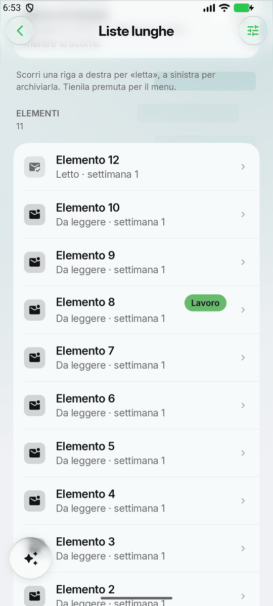
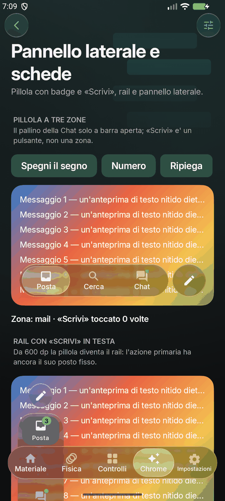
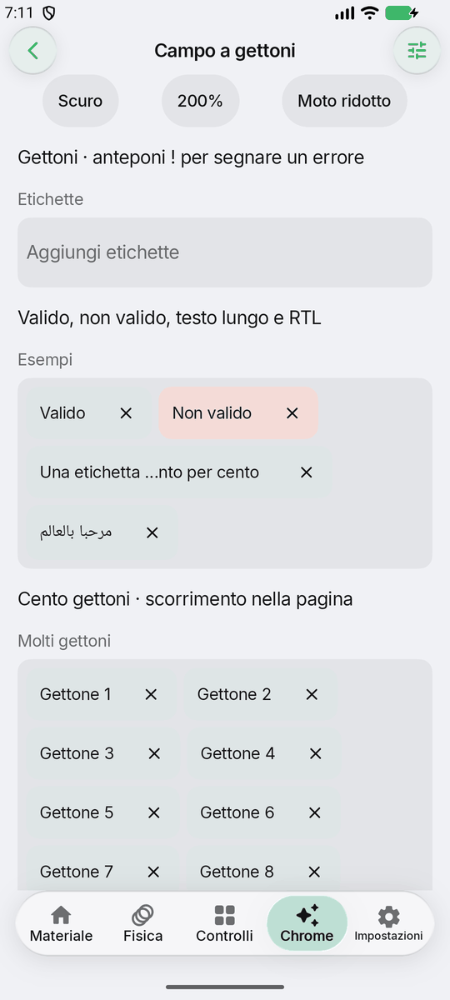
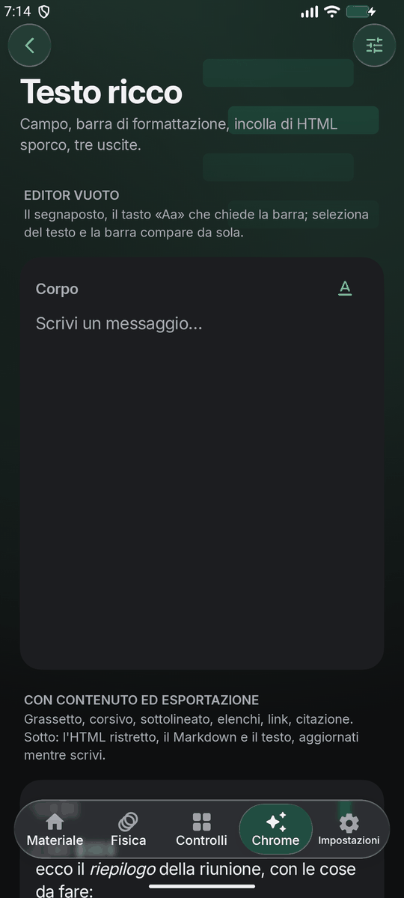
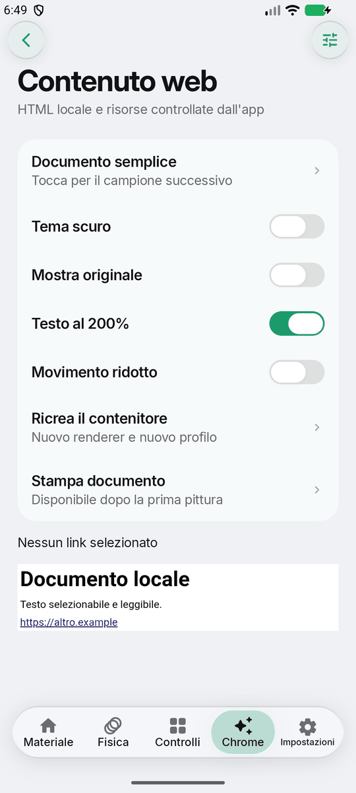
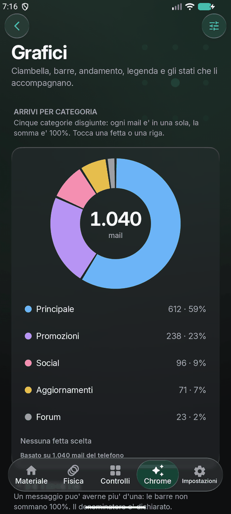

# Fluid Engine

Le fondamenta condivise delle app Android di Antigravity: il design system completo (tema, tipografia, motion, componenti), la persistenza delle impostazioni, l'aggiornamento in-app fuori dallo store, la configurazione remota con i feature flag e il kit per i widget della home.

Non è una libreria generica: è **il** livello su cui è costruita ClasseViva Expressive dalla 7.0.0, estratto per essere riusato senza ricopiarlo a mano ogni volta.

```
engine-foundation   modelli, versioni, manifest remoto, flag      (nessuna dipendenza da Compose)
engine-ui           il design system Fluid: tema, tipografia, motion, componenti
engine-storage      DataStore per le impostazioni dell'engine e la cache del manifest
engine-net          le due chiamate HTTP che l'engine fa da solo (leggi documento, scarica file)
engine-config       il manifest remoto: feature flag, kill switch, versione minima
engine-update       aggiornamento in-app via PackageInstaller (modello Pampa Store)
engine-widget       palette e componenti Glance con lo stesso aspetto dell'app
engine-wear         il design system su Wear OS: FluidWearTheme, dischi e capsule di vetro, anello,
                    riga ad arco, ghiera, always-on (opt-in: solo nel modulo dell'orologio)
engine-ai           l'assistente senza dominio: provider BYOK, chiavi, SSE, failover, orchestratore
engine-ai-ui        l'interfaccia dell'assistente: overlay, chat, impostazioni, halo (opt-in)
engine-ai-bridge    tool federati: un'app espone i suoi tool a un assistente esterno con la stessa
                    firma (ContentProvider a permesso signature), o li chiama
engine-richtext     l'editor di testo con formattazione (elenchi e citazioni annidati, link, barra sopra la
                    tastiera) con HTML ristretto, Markdown e testo semplice (opt-in: solo se serve)
```

## Partire in cinque minuti

Da dentro il repo dell'app:

```powershell
git submodule add <url-del-repo-engine> engine
powershell -ExecutionPolicy Bypass -File engine/tools/engine-install.ps1 -AppRoot .
```

Finche' l'engine e' una cartella locale e non un repo remoto, git rifiuta il trasporto `file` e
serve `git -c protocol.file.allow=always submodule add ...`; senza git c'e' `-Mode copy`.

Lo script aggiunge i moduli al `settings.gradle`, scrive `engine.properties` con la versione agganciata e stampa le righe da incollare nelle dipendenze. Poi:

```kotlin
FluidTheme(settings = engineSettings) {
  // tutta l'app
}
```

Il resto è in [`docs/01-integrazione.md`](docs/01-integrazione.md).

## Aggiornare

Una app per volta:

```powershell
powershell -ExecutionPolicy Bypass -File engine/tools/engine-update.ps1 -AppRoot . -Version 1.1.0
```

Tutte insieme:

```powershell
powershell -ExecutionPolicy Bypass -File tools/engine-update-all.ps1 -Root "C:\VibeCoded Projects" -Version 1.1.0
```

Ogni app resta agganciata alla propria versione: aggiornarne una non tocca le altre. Il modello completo — canali, compatibilità, rollback — è in [`docs/02-aggiornamento.md`](docs/02-aggiornamento.md).

## Cambiare comportamento senza ricompilare

Un solo file JSON ospitato (lo stesso del Pampa Store, in una sezione nuova) decide feature flag, versione minima dell'engine, avvisi e kill switch per **tutte** le app che lo leggono. Vedi [`docs/04-config-remota.md`](docs/04-config-remota.md), e soprattutto [`docs/06-limiti.md`](docs/06-limiti.md): il codice non si aggiorna da remoto, e il documento spiega esattamente dove passa il confine.

## La skill per gli agenti

`skill/fluid-engine/` e' la skill che insegna a un agente le regole del design system, una scheda per ogni
famiglia di componenti e per ogni modulo, il catalogo delle API generato dai sorgenti, le ricette per i compiti
frequenti e come si integra e si aggiorna. Sta dentro questo repo di proposito: cosi' non puo' divergere
dall'engine che descrive. La stessa documentazione, leggibile senza la skill, e' in
[`docs/riferimento/`](docs/riferimento/README.md) (copia generata: non si modifica a mano).

```powershell
# installazione come giunzione (le modifiche sono subito live)
New-Item -ItemType Junction -Path "$env:USERPROFILE\.claude\skillsluid-engine" -Target "<engine>\skillluid-engine"
# oppure una copia, da rifare dopo ogni modifica
Copy-Item -Recurse -Force "<engine>\skillluid-engine" "$env:USERPROFILE\.claude\skills\"
```

Dopo ogni release: `python -I skill/fluid-engine/scripts/gen_api_catalog.py`, aggiornare le schede toccate,
`check_docs.py` e `sync_docs.py` (vedi `skill/fluid-engine/references/strumenti-e-qa.md`).

## Le demo della Fase 1

Schermate vere della galleria (l'app `sample`, Fluid Glass, build di debug) su un emulatore, in tema chiaro e scuro, con i soli dati di prova della galleria. Ogni pagina si apre da «Da provare» o dagli extra di lancio (`gallery.page`, `gallery.theme`, `gallery.text`: vedi `tools/qa/gallery-tour.sh`).

| | | |
|:---:|:---:|:---:|
|  |  |  |
| **Liste lunghe** · `fluidGroupedItems`, scorrimento di lato con azioni (letta, archivia). Pagina «Liste lunghe» | **Pannello laterale e schede** · `FluidDrawer`, pillola a tre zone, rail. Pagina «Pannello laterale e schede» | **Campo a gettoni** · `FluidTokenField`. Pagina «Campo a gettoni» |
|  |  |  |
| **Editor con formattazione** · `engine-richtext`, barra di formattazione. Pagina «Testo ricco» | **Contenuto web** · `FluidWebContent`, HTML locale in una vista chiusa. Pagina «Contenuto web» | **Grafici** · `FluidDonutChart` con legenda. Pagina «Grafici» |

## Documentazione

| | |
|---|---|
| [01 · Integrazione](docs/01-integrazione.md) | mettere l'engine dentro un'app, nuova o esistente |
| [02 · Aggiornamento](docs/02-aggiornamento.md) | versioni, canali, aggiornare una app o tutte |
| [03 · Design system](docs/03-design-system.md) | cosa c'è in `engine-ui` e le regole per usarlo |
| [04 · Config remota](docs/04-config-remota.md) | manifest, flag, kill switch |
| [05 · Widget](docs/05-widget.md) | il kit Glance |
| [06 · Limiti](docs/06-limiti.md) | cosa si aggiorna da remoto e cosa no, senza giri di parole |
| [07 · Assistente](docs/07-ai.md) | `engine-ai`: provider, chiavi, orchestratore, tool |
| [08 · Tool federati](docs/08-ai-bridge.md) | `engine-ai-bridge`: esporre i tool di un'app a un assistente esterno, o chiamarli |
| [Riferimento completo](docs/riferimento/README.md) | una scheda per ogni famiglia di componenti e per ogni modulo, il catalogo API, le ricette e la risoluzione dei problemi (generato dalla skill) |
| [09 · Wear OS](docs/09-wear.md) | `engine-wear`: lo stesso vetro su un orologio, e il vetro che sta fermo quando niente si muove |

## Fluid-physics e l'app Fluid Glass

Dalla 1.9.0 l'engine ha **Fluid-physics** (`engine-ui`, package `ui/fluidphysics`): qualsiasi
forma di vetro diventa qualsiasi altra — rettangolo↔cerchio, sagome disegnate a mano, gruppi di
pezzi che si fondono con ponti liquidi — con la rifrazione che segue la sagoma mentre viaggia.
API: `FluidForm` + `rememberFluidPhysicsState` + `Modifier.fluidPhysicsSurface`; dettagli in
`docs/03-design-system.md`.

Il modulo `sample/` è il suo banco di prova e, dalla 1.0.0, un'app vera del Pampa Store:
**Fluid Glass** (`dev.antigravity.fluidglass`, manifest in `manifest.json`). La scheda Playground
è l'editor del motore: preset, disegno a mano libera, molle e livelli di qualità dal vivo, e il
lato pratico — due tasti che diventano un menù che diventa un pop-up. Chi aveva installato la
vecchia galleria firmata debug deve disinstallarla una volta: la firma è cambiata.

## Sviluppare l'engine

L'engine si apre e si compila da solo:

```bash
./gradlew.bat --no-daemon build
```

Serve un `local.properties` con `sdk.dir` (Android Studio lo scrive da solo aprendo la cartella):

```properties
sdk.dir=C\:\\Android\\Sdk
```

(In un file `.properties` il backslash e i due punti vanno scritti cosi'.)

`settings.gradle` e `build.gradle` alla radice servono **solo** a questo. Quando l'engine è dentro un'app, è il build dell'app a comandare e quei due file non vengono letti.

## Versione

Vedi `ENGINE_VERSION` e `CHANGELOG.md`. La stessa stringa è compilata in `EngineBuild.VERSION`: è quella che il manifest remoto confronta per decidere se una build è troppo vecchia. `tools/engine-doctor.ps1` verifica che le due non divergano.

## Crediti e licenze di terze parti

`engine-ui` distribuisce dentro l'APK tre opere di altri, e le rispettive licenze chiedono che
l'avviso viaggi con la distribuzione. `FluidEngineLicenses` e `fluidLicensesSection()` mettono
l'elenco nella schermata "informazioni" di ogni app senza doverlo riscrivere cinque volte.

| | | |
|---|---|---|
| [AndroidLiquidGlass (`backdrop`)](https://github.com/Kyant0/AndroidLiquidGlass) | Kyant, Copyright 2025 | Apache-2.0 — [`LICENSES/AndroidLiquidGlass.md`](LICENSES/AndroidLiquidGlass.md) |
| [LibrePods](https://github.com/librepods-org/librepods) | LibrePods contributors, Copyright 2025 | **GPL-3.0** — [`LICENSES/LibrePods.md`](LICENSES/LibrePods.md) |
| [Inter](https://github.com/rsms/inter) | Rasmus Andersson | SIL OFL 1.1 — [`LICENSES/Inter.md`](LICENSES/Inter.md) |

**Dalla 3.0 l'engine contiene codice GPL-3.0, e un'app che lo distribuisce è distribuita sotto
GPL-3.0.** È il codice dei pulsanti di LibrePods — la pressione che parte al contatto, la deriva
elastica, i tre colpi aptici — e delle sue pagine — i due strati, la carta, il gesto indietro —
portato com'è, con l'intestazione di provenienza e l'elenco di quello che abbiamo cambiato in ogni
file (`FluidPress.kt`, `FluidButtonGesture.kt`, le parti delle vibrazioni, del bagliore e della lente
che li accompagnano, e `ui/page/*`). È una scelta, fatta apposta: i tasti dell'engine si comportano
esattamente come quelli di LibrePods perché sono i suoi. Chi aggiorna
un'app a 3.0 la porta sotto GPL-3.0: i sorgenti a chi riceve l'APK, la stessa licenza, e la riga
nella schermata "informazioni" che `fluidLicensesSection()` già scrive. Il resto dell'engine resta
com'era (Apache-2.0 dove viene da Kyant).

**Il vetro è di Kyant.** Tutta la rifrazione del Fluid Glass — cattura dello sfondo, lente, bordo
speculare, spessore — è la sua libreria `backdrop`, copiata come sorgente in
`engine-ui/.../ui/glass/backdrop/`. Il perché della copia, e l'elenco completo delle modifiche, sono
nel file di licenza.

Che quella fosse la strada giusta l'abbiamo capito guardando
**[Square](https://github.com/Lelonio/Square)** di [@Lelonio](https://github.com/Lelonio): un client
musicale Android costruito interamente su quel vetro, e la prima implementazione convincente di
Liquid Glass su Android che avessimo visto. Da Square non abbiamo preso codice — è GPL-3.0, e il suo
vetro è la stessa libreria Apache-2.0 che abbiamo preso direttamente da monte — ma il debito è reale
ed è giusto scriverlo.

**[LibrePods](https://github.com/librepods-org/librepods)** è il riferimento dei pulsanti e delle
pagine: i tasti che crescono sotto il dito e le loro vibrazioni della 2.11.0 sono nati guardando come
si comportano i suoi controlli, e fino alla 2.13 era solo comportamento: nessun codice. Dalla 3.0 è
codice — la pressione, il gesto e l'aptica dei pulsanti, e l'apertura delle pagine con il gesto
indietro sotto il dito, sono il suo, portati — e per questo l'engine è **GPL-3.0** come ogni app che
lo distribuisce (vedi sopra e [`LICENSES/LibrePods.md`](LICENSES/LibrePods.md)).
Lo slider come si vede, dalla 2.12.0, è invece il `LiquidSlider` di Kyant (Apache-2.0, come il vetro:
`LICENSES/AndroidLiquidGlass.md`).
